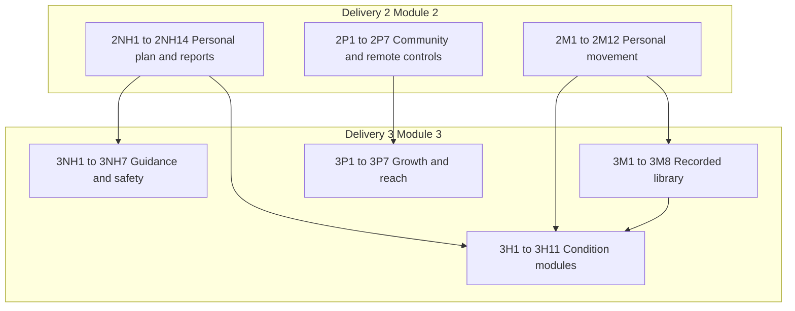

# Deliveries 2–3 Completion (Flutter-first)

## Locked scope

- **Full Final Plan Delivery 2 + 3:** Module 2 (32) + Module 3 + condition modules (30) = **62 items**.
- **Option 3:** pipeline rows (`3NH2`, `3NH5–7`, `3M4–8`, `3P1–7`, `3H8`/`9`/`11`) ship as **Flutter UI + local adapters + contracts**; no live backend/CDN/filming required to call Flutter Done-when.
- **Flutter first:** models, UI, Hive/GetStorage persistence, Mixpanel events, repository interfaces. Backend/admin/Gemini/CDN later against [`docs/delivery2_3/api_contracts.md`](docs/delivery2_3/api_contracts.md) (new).
- **Out of this phase:** production video hosting, live AI spend, merchant gift/group billing, real Health Connect device sync, filmed micro-session content packs (use sample/bundled assets).
- **Canonical source:** [`docs/Final_Plan.pdf`](docs/Final_Plan.pdf). Builds on Delivery 1 handoff (guided workouts, daily log, Luna, food diary, `TierAccessService`, screenings).

## Flutter-first defaults (no later choice)

| Backend-heavy item | Ship now in Flutter |
|---|---|
| Weekly diet adjustment (`2NH3`) | Local rules job: swap/portion suggest from last 7 days logs + prefs; show “what changed”; sync hook unused until API |
| AI grocery (`2NH4`) | Build list from current/local plan meals + phase swap lines from templates |
| Reports / doctor PDF (`2NH10–13`) | Template reports out of Progress beta; extend [`ProgressReportPdfService`](lib/services/progress_report_pdf_service.dart); gate via remote-config-shaped local JSON |
| AI nutritionist (`3NH1`) | Chat shell + FAQ/rules answers from plan/logs; medical safe-reply constants; message caps via `TierAccess`; LLM later |
| Recorded library (`3M1–3`) | Bundled sample VOD catalog JSON + player progress; Active vs Unlimited entitlement table local + `2P5` remote JSON |
| Live replays / filming (`3M5`) | Admin “import replay” stub screen + contract; no Zoom capture |
| Health Connect (`3P3`) | Permission + mock pull UI; store steps/sleep locally; real plugin later |
| Gift / group / website (`3P4`/`5`/`7`) | In-app flows + deep-link stubs; payment/seat APIs stubbed |
| Condition engine (`3H1`) | Config-driven modules (JSON/Dart configs editable without code change where practical); doctor-review placeholders for medical copy |
| Pipeline medical (`3NH6`/`7`, `3H8`/`9`/`11`) | Full screens + rules; copy tagged `pending_doctor_review`; never diagnose |

**Tier model upgrade (extends D1 `X4`):** expand [`TierAccessService`](lib/data/services/tier_access_service.dart) from Free/Plus to **Free | Active | Plus | Unlimited** with feature matrix (guided, photo cap, library share, nutritionist caps, PDF gates). Read plan name/id from auth when present; local override for QA.

---

## Track A — Delivery 2 Nutrition (`2NH1–2NH14`)

**Leverage:** daily check-in / symptoms (D1), food diary + PK food DB, Progress V2 + beta PDF, diet plan V2, trial/signup allergy fields.

1. **`2NH1`** Profile prefs: diet type, hard allergy tags, soft dislikes; filter every plan suggestion / score / grocery / swap.
2. **`2NH2`** After meal confirm: green/amber/neutral phase tag + one-line template reason (no live AI).
3. **`2NH5`/`2NH6`** Extend check-in: hunger 1–5 + craving chips; digestion 4-state + optional note.
4. **`2NH3`/`2NH4`** Weekly local adjuster + grocery list UI (aisle groups, tick-off, rebuild on plan change).
5. **`2NH7`–`2NH9`** Meds/supplements (reminders + taken tick), period flow/spotting day entries → period records, skin/hair chips + severity.
6. **`2NH14`** Period predictor: date **range**, expected length/heaviness/symptoms from history; widen for irregular; sharp-change → gentle doctor prompt.
7. **`2NH10`–`2NH13`** Exit Progress beta for weekly pattern + weekly recap; enrich doctor PDF (meds, cycle, check-in); monthly nutrition/body report + PDF download; gating via `2P5`-shaped settings.

**Order:** `2NH1` → `2NH2` + `2NH5`/`6` → `2NH3`/`4` → `2NH7`–`9` → `2NH14` → `2NH10`–`13`.

---

## Track B — Delivery 2 Movement (`2M1–2M12`)

**Package:** extend [`lib/guided_workout/`](lib/guided_workout/) + home cards.

1. **`2M1`–`2M3`** Pre-workout time/energy picker; per-move swap (too hard / hurts / dislike) with memory + injury feed; weekly auto progression from completions + `1M5` feedback.
2. **`2M4`/`2M5`** Rest/gentle suggestion from logs; wire missed-session sheet to short recovery routine (close D1 `X7` action gap).
3. **`2M6`** Today’s plan card (guided | rest | recorded when library exists) — rules from phase/energy/symptoms/time; replace competing CTAs carefully with D1 `1P10`.
4. **`2M7`–`2M9`** Enhanced streak copy + feedback-shaped next day; fuel tips before/after; women-specific basic sets (core/pelvic/posture) as catalog subsets (approval flag on pelvic moves).
5. **`2M10`/`2M11`** Private progress photo timeline + side-by-side compare; badge share card to community/image (no health data).
6. **`2M12`** Cast: Chromecast/AirPlay integration or large-layout cast screen + documented stopgap mirroring; larger timer/cues UI.

**Order:** `2M1–3` → `2M4–6` → `2M7–11` → `2M12`.

---

## Track C — Delivery 2 Platform (`2P1–2P7`)

1. **`2P5` first** Remote controls: bundled/overridable JSON (feature flags, tier entitlements, photo cap, PDF gate). All later gates read this.
2. **`2P1`/`2P2`** Content poster + community manager shells: draft posts/prompts from approved library ([`1P2`](lib/UI/dashboard_module/posts_module/)); staff approve queue; no live LLM required.
3. **`2P4`** AI cost monitor UI (local counters per feature/user for photo, nutritionist, poster); alert thresholds from remote JSON.
4. **`2P6`/`2P7`** Referral invite code/link + pending reward state; community streak visibility (“N members logged/trained today”) from local/demo count until API.

---

## Track D — Delivery 3 Nutrition (`3NH1–3NH7`)

1. **`3NH3`/`3NH4`** Daily private note; tone/style setting swaps Luna/insight copy variants (calm / high energy) with no extra AI cost.
2. **`3NH1`** Unlimited AI nutritionist chat shell + caps + safe medical reply + cost logging into `2P4`.
3. **`3NH2`** Ramadan mode settings (dates, suhoor/iftar plan split, gentler workouts, fasted/missed day marks) — local rules.
4. **`3NH5`** Cycle calendar month view: predicted phase ranges + food/workout lines from phase rules.
5. **`3NH6`/`3NH7`** Red-flag rule engine + lab upload parse UI for fixed markers (TSH, Vit D, iron, etc.) with trend + `pending_doctor_review` copy.

---

## Track E — Recorded library + Unlimited (`3M1–3M8`)

**New package:** `lib/recorded_library/` (catalog model, local progress, player, filters, admin publish stub).

1. **`3M1`** Library screen: filters (length, level, focus, phase, equipment); player with progress/mark-done; sample catalog asset; admin upload/tag/publish stub → contract.
2. **`3M2`** Trainer style tag + chips on live schedule and library (calm / high energy / strict).
3. **`3M3`** Entitlement table: Active subset vs Unlimited full library; changeable via `2P5` without release.
4. **`3M4`–`3M8` (pipeline shells):** micro-session section + plan-card hooks; replay-import stub; four-week program model/progress UI from existing items; low-data quality toggle + offline download queue (local files); favourites + continue-watching position.

Wire `2M6` recorded option once `3M1` exists.

---

## Track F — Delivery 3 Platform (`3P1–3P7`)

1. **`3P1`** Privacy lock (PIN/biometrics), discreet notification text, app icon/label discreet mode where platform allows.
2. **`3P2`** i18n scaffold: English + Urdu + Roman Urdu for core strings + Luna variants (ARB/l10n); complete coverage iteratively.
3. **`3P3`** Health Connect / HealthKit permission flow + local store for steps/sleep/HR (mock provider until plugins wired).
4. **`3P4`/`3P5`** Gift subscription + mother/daughter UI; group/B2B plan browse/join stubs.
5. **`3P6`** Points ledger from streaks/milestones + redeem catalog (local).
6. **`3P7`** Deep links / in-app webview entry points for free website tools (marketing pages can stay external).

---

## Track G — Condition modules (`3H1–3H11`)

**Leverage:** [`lib/UI/auth_module/pcos/`](lib/UI/auth_module/pcos/) configs (PCOS, thyroid, postpartum, endometriosis, menopause screening).

1. **`3H1` Module engine** Config schema: conditions[], tracking fields, nutrition rules, workout modifiers, notification caps, doctor-report sections, safety prompts. Profile multi-select; cautious rule wins. Load from versioned asset/JSON so content edits avoid app release where possible.
2. **`3H2` PCOS** Complete beyond screening: cycle range, skin/hair/cravings wiring, food rules, strength+cardio intensity, fewer phase nudges, report section, community space entry, safety prompts.
3. **`3H3` Postpartum** Feeding type, cycle prediction off until return, recovery symptoms/mood, staged 5–15 min workouts + C-section stages, recovery nutrition (no deficit), gentle notifs, doctor summary, circle, safety.
4. **`3H4` Thyroid** Under/over choice, med timing reminders (never dose advice), optional labs, symptoms, iodine/selenium food rules, energy-led workouts, lab trend in report, space.
5. **`3H5` Endometriosis** Pain diary (location, 0–10, cycle timing, what helped), flare forecast, anti-inflammatory food rules, low-impact drop on high pain, pre-flare heads-up, doctor pain diary, space, safety.
6. **`3H8`/`3H9`/`3H11`** Full Flutter modules per Final Plan scope (PMS rating window, peri symptoms + strength guidance, fertile window + optional BBT/mucus/OPK + intercourse log); all medical copy `pending_doctor_review`.

**Order:** `3H1` → `3H2` → `3H3`/`3H4` → `3H5` → `3H8`/`9`/`11`.

---

## Suggested build waves (Flutter)

| Wave | Focus | Items |
|---|---|---|
| W1 | Tier matrix + remote controls + prefs/logs | `2P5`, TierAccess 4-tier, `2NH1`, `2NH5–9` |
| W2 | Food scoring, weekly plan, grocery, predictor | `2NH2–4`, `2NH14` |
| W3 | Reports out of beta | `2NH10–13` |
| W4 | Adaptive guided movement | `2M1–9` |
| W5 | Photos, share, cast, platform community | `2M10–12`, `2P1`/`2`/`4`/`6`/`7` |
| W6 | Recorded library + Unlimited | `3M1–3`, then `3M4–8` shells |
| W7 | Guidance NH3 + personalization | `3NH3`/`4`, `3NH1`/`2`, `3NH5–7` |
| W8 | Condition engine + modules | `3H1` → `3H2–5` → `3H8`/`9`/`11` |
| W9 | Growth/privacy/i18n | `3P1–7` |
| W10 | Contracts + Mixpanel + regression QA | `docs/delivery2_3/*`, full matrix |

---

## Contracts + analytics

- New [`docs/delivery2_3/api_contracts.md`](docs/delivery2_3/api_contracts.md): prefs, extended logs, weekly adjust, grocery, reports, nutritionist chat, VOD catalog/progress, entitlements, remote config, referral, condition module config, labs, Health sync, gift/group.
- Extend [`AnalyticsEvents`](lib/data/analytics/analytics_events.dart) for D2/D3 funnels (prefs set, report generated, library play, unlimited gate hit, condition activate, nutritionist message, etc.).
- Medical copy inventory doc listing every `pending_doctor_review` string for founder/doctor sign-off (does not block Flutter Done-when).

---

## Verification (Flutter Done-when)

- Prefs/allergies hard-block plan/score/grocery on sample profiles.
- Check-in logs hunger/cravings/digestion/flow/skin/meds; weekly/monthly/doctor PDF show real numbers; predictor range on 3-cycle fixture.
- Guided: picker/swap/progression/rest/recovery/today card work offline; streaks keep rest days.
- Library: browse/play/finish sample class; Active vs Unlimited gates flip via remote JSON; favourites/continue/download UI work locally.
- Nutritionist chat returns plan-aware FAQ + medical safe reply; cost counter increments.
- Condition engine toggles PCOS (and others) and changes home tips/workout filters/report sections without code edit to the engine.
- Pipeline shells navigable end-to-end with stubs; no crash on missing backend.
- `flutter analyze` on touched code; manual QA matrix per track before calling D2/D3 Flutter-complete.
