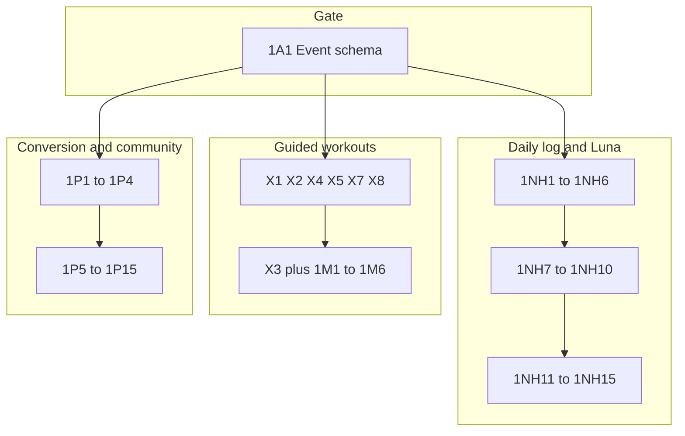

# Delivery 1 Completion (Flutter-first)

## Locked scope

- **Full Final Plan Delivery 1:** 7 audits (`1A1–1A7`) + 7 foundations (`X1–X5`, `X7`, `X8`) + Module 1 (`1NH1–1NH15`, `1M1–1M6`, `1P1–1P15`) = **50 items**.
- **Flutter first:** ship models, UI, local persistence, Mixpanel events, and repository interfaces in this repo. Backend/admin/Gemini batch/CDN/merchant work is **contract + stub** now; wire live later.
- **Out:** Delivery 2/3 modules, condition modules, and anything Final Plan marks pipeline-only until written confirmation.
- **Wave 0 overlaps (verify, do not rebuild):** [`docs/WAVE0_HANDOFF.md`](docs/WAVE0_HANDOFF.md) covers slip upload (`1P5`), paywall cards (`1P7`), screen-detail bugs (`1P11`), trust basics (`1P14`), AAB/ABI (`1P15`). Delivery 1 re-checks them under `1A*` and fills remaining Done-when gaps only.

Canonical source: [`docs/Final_Plan.pdf`](docs/Final_Plan.pdf).

## Flutter-first defaults (no later choice)

| Backend-heavy item | Ship now in Flutter |
|---|---|
| Pakistani food DB (`1NH7`) | Bundled first-batch JSON/SQLite asset + search; remote version URL hook unused until later |
| Meal photo AI (`1NH8–10`) | Camera/gallery confirm UI + repo; local matcher against food DB until recognition API exists |
| Luna batch (`1NH12`) | Five-section card model + template/rules fallback from local logs; consume `dashboard.insight` when present |
| Video hosting (`X5`/`X8`) | Exercise clip URLs in model; ship sample/CDN URL list in assets/config; admin upload UI posts to contract endpoint (no-op/stub) |
| AI community scan (`1P1`) | Client keyword/rule first-pass + existing admin approve queue UI; server AI later |
| AI sales/support (`1P3`) | In-app FAQ/rules assistant shell; LLM later |
| Instant payment (`1P6`) | Activation status UI + poll/push hooks; merchant gateway later |
| Founder dashboard (`1A1` admin) | App emits full event schema via Mixpanel now; admin dashboard deferred |

Offline: queue symptom/check-in/meal writes locally and sync when online (Hive/GetStorage + existing API clients).

---

## Track 0 — Event schema and audits (`1A1–1A7`)

**Primary files:** [`lib/data/services/analytics_service.dart`](lib/data/services/analytics_service.dart), [`lib/helper/analytics_helper.dart`](lib/helper/analytics_helper.dart)

1. **`1A1`** Expand Mixpanel schema to Final Plan list: install, signup, onboarding steps, first log, first workout, paywall view, upgrade tap, payment success/failure, cancel, freeze, refund, push received/opened, session start/length, crash. Single `AnalyticsEvents` catalog; wire call sites as features ship.
2. **`1A2–1A7`** Produce written audit artifacts under `docs/delivery1/` (payment paths, user flows, performance notes, upsell map, engagement map, journey top-5). Fix Flutter-side Sev-1/2 found during audits; queue pure-backend findings for the later phase.
3. **Acceptance:** every D1 funnel action emits a named event; audit docs exist; Wave 0 payment/trust paths re-verified.

---

## Track 1 — Daily logging + Luna (`1NH*`)

**Goal:** one daily log surface for symptoms, mood, energy, stress, sleep, water, meals + Luna/ Free phase message on top.

### 1A. Unify check-in (`1NH2–1NH6`, extend `1NH5`/`1NH6`)

**Leverage:** [`daily_checkin_screen.dart`](lib/UI/auth_module/daily_checkin_screen.dart), [`daily_checkin_model.dart`](lib/data/models/daily_checkin_model.dart) (already has mood/energy/sleepHours/phase), [`paid_water_card.dart`](lib/widgets/paid_home_v2/paid_water_card.dart), [`paid_sleep_card.dart`](lib/widgets/paid_home_v2/paid_sleep_card.dart), [`paid_feel_selector.dart`](lib/widgets/paid_home_v2/paid_feel_selector.dart), [`TodayInsightsBox`](lib/widgets/paid_home_v2/today_insights_box.dart).

- Replace fragmented home taps with **one Quick Daily Check-in** (&lt;30s): mood, energy, stress (+ optional cause), sleep hours + rested (3-point). Fields `1NH3–1NH5` live on this screen, not separate apps.
- Keep water as one-tap add with editable daily goal (`1NH6`); single source of truth via `/users/water_log`.
- Collapse dual sleep writers into check-in + home display of same store.
- Persist date + cycle phase; skipped day = empty (never zero).

### 1B. Symptoms (`1NH1`)

- Daily symptom picker (cramps, headache, bloating, fatigue, nausea, breast tenderness, back pain, acne); severity 1–3; pain body area; editable 48h; offline sync.
- Replace static `_SymptomsCard` bars in [`progress_screen_v2.dart`](lib/UI/dashboard_module/bottom_bar_screen/progress_screen_v2.dart) with real history.

### 1C. Food DB + photo meal log (`1NH7–1NH10`, `1NH9`)

- Bundle first-batch Pakistani/South Asian dishes (English + Roman Urdu, aliases, portions, macros) as versioned asset; search UI used by meal edit and photo confirm.
- New meal-photo flow (camera/gallery → proposed dish/portion → confirm) in place of Spoonacular-name-only path in [`track_calerories.dart`](lib/UI/diet_screen/track_calerories.dart); Free monthly cap + counter via new `TierAccess` (`X4`); Plus uncapped (`1NH10`).
- Edit/correct logged meal in two taps; store correction locally for later recognition training.
- Keep plan adherence meal logs (`MealLog` / `MealLogV2`) for diet-plan followed/skipped; free-form diary is additive, not a replacement.

### 1D. Behavior + Luna + nudges (`1NH11–1NH15`)

- **`1NH11`:** signal events (opens, logs, skips, suggestion taps) via AnalyticsService; two named consumers (insight-type preference, preferred reminder hour).
- **`1NH12`:** widen [`paid_insight_card.dart`](lib/widgets/paid_home_v2/paid_insight_card.dart) to five parts (phase, feel, food tip, movement tip, sleep/rest). Prefer server insight payload; else rules/templates from last 7–14 days of local logs. **No live LLM on open.**
- **`1NH14`:** Free home [`locked_insight_card.dart`](lib/widgets/new_home/locked_insight_card.dart) shows rotating static phase variants + “what Plus adds”; Luna stays locked.
- **`1NH13` / `1NH15`:** local schedules via [`notification_scheduler.dart`](lib/data/services/notification_scheduler.dart) + settings in [`notification_settings_screen.dart`](lib/UI/dashboard_module/profile_screen/notification_settings_screen.dart) (quiet hours, ≤3/day, per-type toggles). Server phase pushes later reuse same prefs.

**NH order:** `1NH1–6` → `1NH7` → `1NH8–10` → `1NH11` → `1NH12–14`; `1NH15` parallel after check-in.

---

## Track 2 — Guided workout foundations (`X*` + `1M*`)

**Important:** live Zoom classes stay as-is ([`docs/workout_module_architecture.md`](docs/workout_module_architecture.md)). Guided workouts are a **new module**, not an extension of Zoom.

**New package area:** `lib/guided_workout/` (models, repositories, player UI) + assets for sample clips.

1. **`X1`** Exercise list model: id, names, body area, impact, equipment, injury conflicts, easier/harder variants, cue text/voice asset keys.
2. **`X2`** Add tag fields on live class/slot models + filter chips on schedule UI (intensity, focus, style, phase) — data may be partial until backend tags exist; UI reads optional tags.
3. **`X8` / `X5`** Clip entries with stream URLs; player loads URL/asset; stub upload screen for staff that POSTs multipart to documented endpoint.
4. **`X3`** Workout player: step list, animated/clip view, timer, mark-done per move and session complete.
5. **`X4`** `TierAccessService`: photo-log monthly counter, guided-workout access, freeze/renewal date reads from existing auth/plan fields + local counters; upgrade prompts call into `1P9`.
6. **`X7`** Missed-session sheet with correct slot data + primary action (deep-link to guided short workout when `1M3` ready; else reschedule/join next). Fix wrong session data on existing missed/consultant sheets.
7. **`1M1`** Injury filter: onboarding injuries → exclude conflicting exercises/classes.
8. **`1M2`** Shared intensity rule from phase + energy/stress/sleep + user override; applies to guided routines and Recommended class badge.
9. **`1M3`/`1M4`** Rule-built routines from clips; voice + written cues (toggleable).
10. **`1M5`** End-of-workout too easy / right / too hard.
11. **`1M6`** Milestone badges (3/7/30 day, first workout, first log) + celebration; rest day does not break streak (local rule).

**Movement order:** `X1, X2, X5, X8, X4, X7` → `X3` + `1M1/1M2` → `1M3/1M4` → `1M5/1M6`.

---

## Track 3 — Conversion / community (`1P*`)

1. **`1P1`** Client first-pass filter on create-post; flagged posts go to existing [`admin_approve_posts.dart`](lib/UI/dashboard_module/posts_module/admin_approve_posts.dart) queue with status badge.
2. **`1P2`** Approved content library screen (seeded local/CMS list) + review queue entry points for staff.
3. **`1P4`** Report / block / anonymous posting on feed + post detail (no UI today).
4. **`1P3`** In-app support assistant shell (FAQ + ticket handoff); wires after payment states clear.
5. **`1P5`/`1P7`/`1P11`/`1P14`/`1P15`** Regression against Wave 0 handoff checklist; close remaining Done-when gaps only (e.g. plan-active push copy if missing).
6. **`1P6`** Instant-activation UX: pending → active states, refresh plan status; gateway later.
7. **`1P8`/`1P9`** Harden trial/first-week flow; session-capped upgrade moments (photo cap, locked Luna, tier gates) once per session via `TierAccess`.
8. **`1P10`** Home one daily focus: single primary CTA (check-in, workout, or Luna) on [`paid_home_screen_v2.dart`](lib/screens/paid_home_screen_v2.dart) / unpaid home — cut competing cards.
9. **`1P12`** Personal first-week message pack (day 1–7) feeding Luna empty-state and Free home.
10. **`1P13`** Renewals/freeze/win-back: extend existing freeze UI + local reminder schedules; sequences can deepen when backend exists.

**P order:** `1P1/1P2` → `1P4` → payment verify `1P5/1P7/1P8` → `1P6/1P9` → `1P10–1P12` → `1P13–1P15` (verify-heavy) → `1P3` near end.

---

## Suggested build waves (Flutter)

| Wave | Focus | Items |
|---|---|---|
| W1 | Schema + unify logging | `1A1`, `1NH1–1NH6`, start `1A2/1A3` |
| W2 | Food diary + tier counters | `1NH7–1NH10`, `X4`, `1P9` hooks |
| W3 | Luna + reminders + home focus | `1NH11–1NH15`, `1NH14`, `1P10`, `1P12` |
| W4 | Guided foundations | `X1,X2,X5,X8,X7` then `X3` |
| W5 | Guided product | `1M1–1M6` |
| W6 | Community + conversion close | `1P1–1P4`, `1P6`, `1P8`, verify `1P5/7/11/14/15`, `1P13` |
| W7 | Audits close + QA | `1A2–1A7`, regression, contract doc handoff |

---

## Contracts to document for backend-later

Add `docs/delivery1/api_contracts.md` covering: symptom upsert, extended daily check-in (stress/cause/restedness), food DB version pull, meal-photo recognize + correction, Luna 5-part batch payload, tier remote caps, exercise/clip CRUD + hosting, community moderation score, report/block, instant activation webhook, phase push triggers. Flutter repos implement against these shapes with local adapters now.

---

## Verification (Flutter Done-when)

- Check-in + symptoms &lt; 30s; offline entry syncs; Progress shows real symptom history.
- Food search finds English/Roman Urdu dishes; photo flow confirms meal; Free cap blocks with upgrade; Plus unlimited; edit updates totals.
- Plus: five-part Luna card without live AI on open; Free: rotating phase message, Luna locked.
- Guided: first routine plays end-to-end (clip/timer/cues/mark done); injuries excluded; intensity follows phase/logs; feedback + badges unlock.
- Community: report/block/anonymous work; flagged → approve queue.
- Wave 0 payment/trust paths still pass; Mixpanel shows new schema events for a test week.
- `flutter analyze` on touched code; manual QA matrix per track before calling Delivery 1 Flutter-complete.
