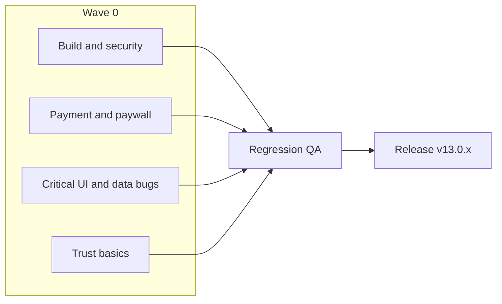

# Wave 0 Completion Plan

## Scope (locked)

Wave 0 ships **revenue + trust + critical polish** only. It is **not** the full [My_14_DayPlan](docs/My_14_DayPlan.pdf) 65-item close.

**In:** payment slip fix, Android size/AAB/permissions cleanup, paywall trust/copy, critical UI/data bugs, hide admin login, privacy notice start.

**Out:** dark mode, full a11y/VoiceOver, AI credits, referral program, community AI moderation, home full redesign, freeze win-back sequences, Delivery 1 features (Luna, food DB, guided workouts).

---

## Track A — Build and security (Android)

**Files:** [android/app/build.gradle](android/app/build.gradle), [android/app/src/main/AndroidManifest.xml](android/app/src/main/AndroidManifest.xml)

1. **AAB + ABI cut** — Add `ndk.abiFilters` for `arm64-v8a` (and `armeabi-v7a` only if still required for min devices). Document that Play must distribute **AAB**, not a universal APK. R8/`minifyEnabled`/`shrinkResources` are already true; verify release build still works.
2. **Permissions** — Remove `SYSTEM_ALERT_WINDOW` if Zoom no longer needs overlay; audit merged manifest for ad/enterprise permissions pulled by deps and exclude or remove unused plugins. Source already lacks CALL_PHONE / Zebra / READ_PHONE_STATE — confirm via `./gradlew :app:processReleaseMainManifest` after changes.
3. **Acceptance:** Release AAB size meaningfully down from ~570 MB universal APK; no unused dangerous permissions in merged manifest.

---

## Track B — Payment and paywall

**Files:**
- [lib/UI/plans_module/upload_slip_screen.dart](lib/UI/plans_module/upload_slip_screen.dart) (P-01)
- [lib/UI/plans_module/all_plans.dart](lib/UI/plans_module/all_plans.dart)
- [lib/widgets/v2/v2_price_card.dart](lib/widgets/v2/v2_price_card.dart) (always injects `'Customized diet plan'`)
- [lib/widgets/meal_details.dart](lib/widgets/meal_details.dart) (`Early Detection` chip)
- [lib/UI/plans_module/refund_policy.dart](lib/UI/plans_module/refund_policy.dart) (exists but not linked from paywall)

1. **P-01 slip upload** — Fix camera/gallery → `planPicture` assignment so submit does not toast `"Please select an image first"` while picker is open. Show error only after dismiss-with-no-image; put error inside the upload card; add loading on Submit and a clear success/next-status state.
2. **Paywall differentiation** — Differentiate cards visually (e.g. Most Popular on recommended plan); stop showing identical feature bullets for every plan; remove diet bullet from workout-only when plan type indicates workout-only (API-driven titles — gate on plan metadata, not hardcoded Aasma/Irum).
3. **Trust copy** — Link refund/cancellation to [refund_policy.dart](lib/UI/plans_module/refund_policy.dart) before Subscribe; reword medical-claim chips (`Early Detection` → fitness outcome language).
4. **Trial clarity** — Verify on a test account whether any trial path exists. If backend/feature already supports it, surface the offer on the plan page; if not, document “no trial in app” for client (do not invent a full trial system in Wave 0).
5. **Acceptance:** Slip upload works camera + gallery on low-end and recent Android; paywall shows clear hierarchy + refund link; no false diet feature on workout-only.

---

## Track C — Critical UI and data bugs

| ID | Fix | Primary file(s) |
|----|-----|-----------------|
| D-04 greeting | Sanitize name: reject empty/`last`/placeholders; fallback firstName → username → `"there"` | [v2_diet_hero.dart](lib/widgets/v2/v2_diet_hero.dart), [paid_hero_greeting.dart](lib/widgets/paid_home_v2/paid_hero_greeting.dart), [hero_greeting_block.dart](lib/widgets/new_home/hero_greeting_block.dart) |
| D-03 day counter | Clamp `todaysDayNumber` to `planDays`; show ended state when past plan | [v2_diet_hero.dart](lib/widgets/v2/v2_diet_hero.dart), [diet_plan_user_controller.dart](lib/data/controllers/diet_plan_user_controller/diet_plan_user_controller.dart) |
| U-01 stacked sheets | Enforce single sheet: Day7 must fully dismiss before booking; fix [book_initial_reminder_sheet.dart](lib/UI/consultation_module/popups/book_initial_reminder_sheet.dart) `onBookNow` path | [popup_orchestrator.dart](lib/UI/consultation_module/popup_orchestrator.dart) |
| U-03 Mark All Read | Neutral/secondary style, not `Colors.red` | [notification_screen.dart](lib/UI/dashboard_module/home_screen/notification_screen.dart) |
| U-14 meals placeholder | Hide or relabel when meals logging is live; drop bare `'Meals · coming soon'` | [progress_screen_v2.dart](lib/UI/dashboard_module/bottom_bar_screen/progress_screen_v2.dart) |
| FAB | Confirm no dual FABs on Home; remove or leave unused [medical_concern_fab.dart](lib/widgets/v2/medical_concern_fab.dart) unmounted | [bottom_bar_screen.dart](lib/UI/dashboard_module/bottom_bar_screen/bottom_bar_screen.dart) |

**Acceptance:** No “Hi last”, no “Day N of M” with N>M, never two consultation sheets at once, Mark All Read non-destructive color, Progress does not show misleading meals coming-soon.

---

## Track D — Trust basics

1. **Hide Team/Admin login** — Remove visible `_buildTeamAdminButton` from [login.dart](lib/UI/auth_module/login/login.dart); keep access via hidden gesture (e.g. long-press logo) or deep link so staff can still log in.
2. **Privacy notice start** — Make Privacy Policy / Terms tappable on [signup_screen_user.dart](lib/UI/auth_module/sign_up_screen/signup_screen_user.dart); add a short plain health-data notice (what is stored, contact to delete) on signup + Profile. Full “discreet mode” stays out of Wave 0.
3. **Acceptance:** Consumer login has no admin CTA; signup shows real privacy/terms entry points.

---

## Suggested day order (~10 working days)

| Days | Focus |
|------|--------|
| 1–2 | Track A build/security + greeting + day counter + Mark All Read + meals placeholder |
| 3–4 | P-01 slip + stacked popups + hide admin login |
| 5–6 | Paywall differentiation + refund link + chip copy + trial verification |
| 7 | Privacy notice wiring |
| 8–9 | Regression (payment paths, login roles via hidden entry, diet/home greetings, Android release AAB) |
| 10 | Buffer / client sign-off build |

---

## Verification

- Manual: slip camera/gallery; plan page; login (user + hidden staff); Diet/Home greeting; diet day banner after plan end; Day7 then booking; notifications Mark All Read.
- Android: release AAB install from Play internal track or local bundletool; check merged manifest permissions.
- No new CI required for Wave 0, but run `flutter analyze` on touched Dart files and a release build before handoff.

## Client-facing outcome

Ship as **v13.0.x stabilize release**: payment path works, app download thinner, embarrassing bugs gone, paywall clearer, admin entry hidden, privacy entry started — ready to start Delivery 1 without losing trust or revenue.